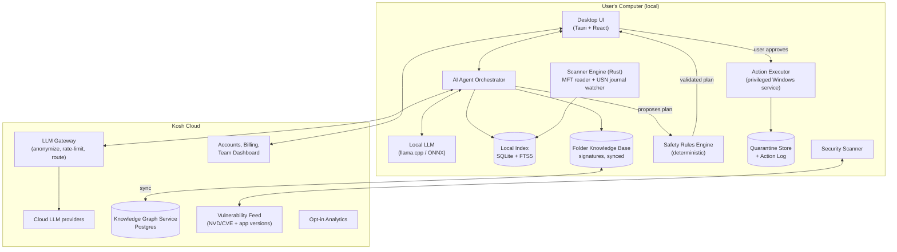

# Kosh AI — The Storage Assistant That Explains Before It Deletes

> **Working name:** *Kosh* (कोश, "storehouse / treasury"). Other name ideas are in [Section 25](#25-name-ideas).
> **Document type:** Full startup blueprint: product, technology, business, go-to-market, roadmap, and YC application.
> **Version:** 1.0 · October 2026 · Prepared for: Shaan (Fastliq)

---

## Table of Contents

1. [One-Line Pitch & TL;DR](#1-one-line-pitch--tldr)
2. [The Problem](#2-the-problem)
3. [Why Now](#3-why-now)
4. [The Solution & Product Principles](#4-the-solution--product-principles)
5. [Who It Is For (Personas)](#5-who-it-is-for-personas)
6. [Full Feature List](#6-full-feature-list)
7. [User Journeys & Example Conversations](#7-user-journeys--example-conversations)
8. [System Architecture](#8-system-architecture)
9. [Technology Stack (and Why)](#9-technology-stack-and-why)
10. [How the AI Works](#10-how-the-ai-works)
11. [Safety System: "Never Delete the Wrong Thing"](#11-safety-system-never-delete-the-wrong-thing)
12. [Privacy & Product Security](#12-privacy--product-security)
13. [Security Scanner (Vulnerability Detection)](#13-security-scanner-vulnerability-detection)
14. [Competition](#14-competition)
15. [The Moat](#15-the-moat)
16. [Business Model & Pricing](#16-business-model--pricing)
17. [Unit Economics](#17-unit-economics)
18. [Market Size](#18-market-size)
19. [Go-To-Market & Growth Loops](#19-go-to-market--growth-loops)
20. [Roadmap](#20-roadmap)
21. [Team & Hiring](#21-team--hiring)
22. [Resources: Learning, Tools, Data, Budget](#22-resources-learning-tools-data-budget)
23. [Metrics That Matter](#23-metrics-that-matter)
24. [Risks & How We Handle Them](#24-risks--how-we-handle-them)
25. [Name Ideas](#25-name-ideas)
26. [Y Combinator Application Angle](#26-y-combinator-application-angle)
27. [Your First 30 Days: Action Checklist](#27-your-first-30-days-action-checklist)
28. [Appendix: Schemas, Code Skeletons, Protected Paths](#28-appendix-schemas-code-skeletons-protected-paths)

---

## 1. One-Line Pitch & TL;DR

**One line:**
> Kosh is an AI assistant for your computer's storage. Ask it anything: *"What is this folder? Where is it saved? What breaks if I delete it?"* It finds the space you can safely free and never deletes anything without your permission.

**TL;DR**

| | |
|---|---|
| **Problem** | Devices fill up. People don't know what is safe to delete. They either delete important things by mistake, or they waste money on pen drives, hard disks, and cloud plans. |
| **Insight** | Existing cleaners show *what is big*. Nobody explains *what it is, who uses it, and what happens if it's gone*. That explanation is the missing piece, and AI can now provide it. |
| **Product** | A desktop app (Windows first) with a fast scanner, a chat assistant, a traffic-light safety system, impact analysis, permission-gated deletion with 30-day undo, and a security check. |
| **Moat** | A growing **"Folder Knowledge Graph"**: a database that knows which app owns which folder and what is safe to remove. It gets smarter with every user. |
| **Business** | Freemium. Free scan + basic cleaning; Pro ~$3–5/month (India: ~₹99–149/month); Teams/IT edition per device; OEM preinstall deals later. |
| **Wedge** | Students, developers, and budget-laptop owners (256–512 GB SSDs) in India and other emerging markets, then global. |
| **Promise** | *No scareware. No ads. No fake "247 problems found!" alerts.* A trustworthy brand in a category known for distrust. |

---

## 2. The Problem

### 2.1 What happens today

1. A warning pops up: **"Low disk space."**
2. The user opens File Explorer. They see `C:\` is almost full, with folders like `AppData`, `ProgramData`, `WinSxS`, `$Recycle.Bin`, and `node_modules`. They have no idea what any of these are.
3. They do one of three bad things:
   - **Delete randomly.** They remove a folder that "looks useless". A game stops working, an app loses its settings, or college project files disappear.
   - **Do nothing.** The laptop gets slow, updates fail (Windows updates need free space), and photos can't be saved.
   - **Spend money.** They buy a pen drive, an external hard disk, or a cloud plan, often when 30–80 GB could have been freed safely.

### 2.2 Why existing tools don't solve it

| Tool type | What it does | What's missing |
|---|---|---|
| Windows Storage Sense / Disk Cleanup | Removes temp files and the recycle bin | Very limited. Doesn't explain, doesn't touch most of the real space. |
| Disk visualizers (WinDirStat, WizTree, TreeSize) | Show *where* the big folders are | No meaning. "`C:\Users\you\AppData\Local\Packages\…` is 14 GB." So what? Is it safe? |
| "Cleaners" (CCleaner etc.) | One-click junk cleaning, registry tools | Black box. The category has a reputation for scare tactics and aggressive upsells. |
| Phone "AI cleaners" | Duplicate photos | Phone-only, mostly photos, often ad-heavy. |
| Asking ChatGPT/Google | General advice | Can't see *your* machine. Generic answers like "it depends". |

### 2.3 The real, deeper problem

> **People don't have a storage problem. They have an *understanding* problem.**

The space is usually there. Users just can't tell **junk** apart from **important** files. Kosh fixes the understanding, and freed space follows from that.

### 2.4 Pain stories (use these in your pitch)

- **Riya, 2nd-year engineering student:** 256 GB laptop. Android Studio + emulator images + three old projects with `node_modules` = 60+ GB. She deleted her `Documents` folder thinking it was "system stuff" and lost assignments.
- **Arjun, gamer:** Bought a ₹5,000 external SSD. 40 GB of old game shader caches, leftover installers, and duplicate downloads were sitting on his drive.
- **Mrs. Sharma, parent:** The family laptop is "full". WhatsApp Desktop media is 18 GB, and photos are backed up twice. She doesn't know what any folder means and is scared to touch anything.
- **Small office (10 PCs):** The IT person spends hours each month freeing space manually and has no visibility across machines.

---

## 3. Why Now

1. **AI can finally explain.** Large language models can turn a cryptic path into plain language ("This is Chrome's cache. It rebuilds itself. Safe to clear.") and answer follow-up questions in any language, including Hindi, Tamil, and Hinglish.
2. **AI can run on the device.** Small open models (Qwen, Llama, Gemma, Phi families) now run on normal laptops through llama.cpp / Ollama / ONNX Runtime, and new "AI PCs" ship with NPUs. That means a private, offline, near-zero-cost AI for the free tier.
3. **Storage per rupee isn't keeping up with storage needs.** Budget laptops still ship with 256–512 GB SSDs, while apps, games (often 100 GB+), 4K phone videos, and dev tools keep growing.
4. **People are getting used to AI agents acting for them.** Users now expect an assistant that *does things*, but they also want control and an undo button. A "permission-first agent" is the right product shape for this moment.
5. **Trust gap in the category.** Old cleaner brands carry baggage (scareware perception, privacy incidents, a 2017 supply-chain attack on a popular cleaner). A new, transparent, privacy-first brand can win.

---

## 4. The Solution & Product Principles

### 4.1 What Kosh is

A desktop app with four layers:

```
┌──────────────────────────────────────────────────────────┐
│  1. SEE      Fast scan + visual storage map              │
│  2. UNDERSTAND  AI explains every folder; ask anything   │
│  3. DECIDE   Traffic-light safety + "what breaks" check  │
│  4. ACT      Permission-gated cleanup with 30-day undo   │
└──────────────────────────────────────────────────────────┘
```

### 4.2 The seven product principles (non-negotiable)

1. **Permission first.** The AI *proposes*. The user *approves*. Nothing is ever deleted automatically unless the user created an explicit rule for it.
2. **Always explainable.** Every suggestion shows *why*: owner app, size, last used, how to get it back, and a confidence level.
3. **Always undoable.** Every action is logged and reversible (quarantine / Recycle Bin / restore point) for at least 30 days.
4. **Show evidence, not fear.** No "1,247 problems found!" No red alarm screens. Just facts: "You can safely free 38 GB."
5. **Local first, private by default.** File *contents* are never uploaded. Metadata is minimized and anonymized before any cloud call.
6. **System files are locked.** Core OS folders are untouchable from the app, even if the user or the AI asks.
7. **Honest business.** No ads, no selling data, no fake urgency. Revenue comes only from people who find it valuable.

---

## 5. Who It Is For (Personas)

| Persona | Device | Main pain | What they need from Kosh | Will they pay? |
|---|---|---|---|---|
| **Student** (India/emerging markets) | 256–512 GB Windows laptop | Constantly full; scared to delete | Simple explanations, Hindi/Hinglish, "safe clean" button | Low price (₹99–149/mo or yearly), student discounts |
| **Developer** | Windows/Mac, many projects | `node_modules`, Docker, Gradle, Android SDK, venvs, build caches | Dev-aware cleanup with "how to rebuild" commands | Yes, highly (time = money) |
| **Creator / video editor** | Big drives, still full | Raw footage, render caches, project files | Find old footage, offload to cloud/external, cache cleanup | Yes |
| **Gamer** | 1 TB+ but games are huge | Shader caches, old launchers, unused games | "Games you haven't played in 6 months", launcher-aware cleanup | Medium |
| **Non-technical family user** | Shared laptop | Fear + confusion | Voice/plain-language assistant, "Is this safe?" | Through family plan |
| **Small business IT** | 5–200 PCs | No visibility, manual cleanup | Fleet dashboard, policies, reports | Yes (B2B) |

**Beachhead (first market):** **students + developers on Windows in India.** They have the highest pain, they're active online, they spread tools by word of mouth, and they are reachable through colleges, YouTube, Reddit, Discord, and GitHub.

---

## 6. Full Feature List

Priority labels: **P0** = MVP (must ship first), **P1** = V1 (months 3–6), **P2** = V2 (months 6–12), **P3** = Moonshot.

### 6.1 Core: See & Understand

| # | Feature | What it does | Priority |
|---|---|---|---|
| F1 | **Lightning Scan** | Scans the whole drive in seconds by reading the NTFS Master File Table (the same approach WizTree uses). Falls back to normal folder walking on other file systems. | P0 |
| F2 | **Storage Map** | Visual treemap/sunburst of what fills the drive, grouped by *meaning* (Apps, Games, Photos, Dev, System, Cache), not just folders. | P0 |
| F3 | **"Where is it?" Locator** | Ask "Where are my WhatsApp photos?" and get a breadcrumb: `This PC › C: › Users › Shaan › Documents › WhatsApp › Media` with size and an **[Open Folder]** button. | P0 |
| F4 | **Folder Explainer** | Click any folder and get a plain-language card: what it is, which app owns it, last used, size trend, safe or not, and how to recover it. | P0 |
| F5 | **Chat Assistant** | Ask anything about your storage in natural language. Multilingual (English, Hindi, Hinglish, and more). | P0 |
| F6 | **App Ownership Graph** | Links every folder to the app that created it, using install records, signatures, and process history. | P0 (basic) → P1 (deep) |
| F7 | **Space Timeline** | "Your drive grew 22 GB this month. 15 GB came from Telegram downloads." | P1 |
| F8 | **Space Forecast** | "At this rate your C: drive will be full in 26 days." | P1 |

### 6.2 Core: Decide Safely

| # | Feature | What it does | Priority |
|---|---|---|---|
| F9 | **Traffic-Light Safety** | 🟢 Safe (cache, temp, installers) · 🟡 Review (old/unused personal files, duplicates) · 🔴 Locked (OS, active app data). | P0 |
| F10 | **Impact Analysis ("What breaks?")** | Before deletion: "This is used by Adobe Premiere. Deleting it breaks the app. Uninstall Premiere properly instead to free 6.1 GB." | P0 |
| F11 | **Confidence Score** | Every suggestion shows confidence (e.g. 98% safe) plus the evidence behind it. | P0 |
| F12 | **"Last Used" Intelligence** | Combines last-access time, last-modified time, app launch history, and recent-file lists, because Windows doesn't always update the "last opened" date. | P1 |
| F13 | **Smart Plan** | "Find me 20 GB" → a ranked plan from safest to least safe, stopping once the goal is reached. | P0 |

### 6.3 Core: Act with Permission

| # | Feature | What it does | Priority |
|---|---|---|---|
| F14 | **Permission Gate** | Every action shows a preview list with checkboxes and a final confirm. Red items can't be selected. | P0 |
| F15 | **Quarantine + 30-day Undo** | Removed items go to a safe holding area first. A one-click **Restore** button. (See Section 11.4 for the important "quarantine doesn't free space" problem and how to solve it.) | P0 |
| F16 | **Action Log / Time Machine** | A full history of what was removed, when, why, and how much space it freed. | P0 |
| F17 | **Proper Uninstall** | Uninstalls apps through their official uninstaller, then finds leftovers and asks about them. | P1 |
| F18 | **Restore Point Before Big Actions** | Creates a Windows System Restore point before large cleanups (when enabled). | P1 |

### 6.4 Specialized Cleaners (each is a reason to download)

| # | Feature | What it does | Priority |
|---|---|---|---|
| F19 | **Developer Mode** | Finds `node_modules`, Python venvs, `__pycache__`, Gradle/Maven caches, Android SDK images, Xcode DerivedData, Rust `target/`, Docker images/volumes, old Unity/Unreal caches. Shows the **rebuild command** ("run `npm install` to restore"). Respects git: never touches uncommitted work. | P1 (big wedge, start early) |
| F20 | **Duplicate & Similar Photo Finder** | Exact duplicates (hash) + near-duplicates (perceptual hash) + burst shots + blurry photos + old screenshots. Keeps the best one by default. | P1 |
| F21 | **Messaging App Media** | WhatsApp, Telegram, Discord, Teams caches and downloaded media, with "forwarded memes" detection. | P1 |
| F22 | **Game Manager** | Steam/Epic/Xbox/Riot-aware. "You haven't played GTA V in 8 months, 110 GB. Uninstall (your saves are in the cloud)?" | P1 |
| F23 | **Downloads Doctor** | Old installers (`.exe`, `.msi`, `.zip` already extracted), duplicate downloads, half-finished downloads. | P0 |
| F24 | **Big & Forgotten Files** | Large files not opened in 6+ months, grouped by type. | P0 |
| F25 | **Video Shrinker** | Compresses large phone videos (H.265/AV1) with a preview of quality. Often saves 50–70%. | P2 |
| F26 | **Windows Deep Clean (safe way)** | Uses *official* tools for system areas: DISM component cleanup for `WinSxS`, `Windows.old` removal, hibernation file explanation, Delivery Optimization cache. Never deletes system files directly. | P1 |

### 6.5 Security & Health

| # | Feature | What it does | Priority |
|---|---|---|---|
| F27 | **Security Check** | Outdated apps with known vulnerabilities, unknown startup programs, suspicious executables, secrets left in plain text. Full details in [Section 13](#13-security-scanner-vulnerability-detection). | P1 |
| F28 | **Disk Health (SMART)** | Reads drive health and warns before the SSD/HDD fails: "Back up now." | P1 |
| F29 | **Sensitive File Finder** | Finds scans of Aadhaar/PAN/passport, bank statements, and password files in random places, and suggests a safe location or encryption. | P2 |

### 6.6 Save Money & Space Without Deleting

| # | Feature | What it does | Priority |
|---|---|---|---|
| F30 | **"Before You Buy" Advisor** | "You need 30 GB. I can free 42 GB safely. You don't need a pen drive yet." | P0 (as a message) |
| F31 | **Smart Offload** | Moves old files to OneDrive/Google Drive/external disk and keeps a searchable "ghost index" so you still know where everything is. | P2 |
| F32 | **Move Apps to Another Drive** | Moves games/apps from C: to D: the proper way (through launchers). | P2 |
| F33 | **Compress in Place** | Uses NTFS compression / CompactOS for rarely used folders, with zero data loss. | P2 |

### 6.7 Automation & Habit

| # | Feature | What it does | Priority |
|---|---|---|---|
| F34 | **Rules / Autopilot** | User-written rules in plain language: "Every week, clear installers in Downloads older than 30 days." Rules show a preview the first time and send a weekly summary. | P1 |
| F35 | **Weekly Digest** | "This week: +4 GB. Freed 6 GB. Your drive is healthy." | P1 |
| F36 | **Low-Space Guardian** | When space drops below a threshold, Kosh opens a ready plan instead of Windows' scary warning. | P1 |
| F37 | **Shareable Space Report** | A beautiful card: "I freed 63 GB with Kosh 🚀". Built-in virality. | P0 |

### 6.8 Multi-Device, Family & Business

| # | Feature | What it does | Priority |
|---|---|---|---|
| F38 | **Family Dashboard** | See all family laptops in one place. Approve cleanups remotely. | P2 |
| F39 | **Phone Companion** | Android app (photos, WhatsApp media, duplicates); iOS is limited by Apple's restrictions. | P2 |
| F40 | **Kosh for Teams (IT)** | Fleet view, policies ("never let C: go under 15%"), remote cleanup with employee approval, reports, SSO, MDM deployment (Intune). | P2 |
| F41 | **MSP / Reseller Portal** | IT service providers manage many companies. | P3 |

### 6.9 Moonshots (the "YC-level" vision)

| # | Feature | Vision | Priority |
|---|---|---|---|
| F42 | **Folder Knowledge Graph (public)** | The world's largest open database of "what is this folder and is it safe to delete?". It powers SEO, an API, and other products. | P2 → P3 |
| F43 | **Kosh API / SDK** | Lets other apps (OEM tools, antivirus, backup software, IT tools) call "explain this path" and "is this safe?". | P3 |
| F44 | **Personal File Brain** | Beyond cleanup: "Find the PDF my professor sent in March", semantic search across all files, local and private. Kosh grows from a *storage cleaner* into a *file intelligence layer for your computer*. | P3 |
| F45 | **OEM Preinstall** | Preinstalled on budget laptops (Indian and global OEMs) as the "storage assistant". Huge distribution. | P3 |

> **The big vision:** Kosh starts as the safest way to free space. It ends as **the AI that understands everything on your computer**: storage, files, security, and health.

---

## 7. User Journeys & Example Conversations

### 7.1 First run (target: value in under 3 minutes)

```
Install (30 MB, signed) → Welcome: "I'll look at file names and sizes, never contents."
   → Scan C: (≈10–60 sec) → Health Report:
        "Your C: drive: 476 GB, 459 GB used (96%)
         🟢 Safe to free now:        31.4 GB   [Review & Clean]
         🟡 Worth reviewing:         48.2 GB   [Show me]
         🔴 System/app (locked):    210.0 GB
         💡 You don't need a new drive."
   → User clicks "Review & Clean" → preview list → Confirm → "Freed 31.4 GB 🎉"
   → [Share my Space Report]   [Ask Kosh anything]
```

### 7.2 Example conversations

**"Where is it saved?"**
> **You:** where does my minecraft save worlds
> **Kosh:** Your Minecraft worlds are here:
> `This PC › C: › Users › Shaan › AppData › Roaming › .minecraft › saves` (3.2 GB, 7 worlds)
> `AppData` is a hidden folder, which is why you couldn't find it. **[Open folder]** **[Back up worlds]**

**"Can I delete this?"**
> **You:** can i delete C:\Users\Shaan\AppData\Local\Android\Sdk\system-images
> **Kosh:** 🟡 **Review.** These are Android Emulator images (19.4 GB) used by Android Studio.
> - Last used: **9 months ago**
> - If deleted: the emulator won't start until you download an image again (Android Studio → SDK Manager, ~15 min).
> - Your code and projects are **not** affected.
> Suggestion: keep the newest image (API 34, 6.1 GB) and remove the 3 old ones to free **13.3 GB**. **[Do this]** **[Keep all]**

**"What breaks?"**
> **You:** what happens if i delete ProgramData\NVIDIA Corporation
> **Kosh:** 🔴 **Locked.** This folder contains your NVIDIA graphics driver settings and installer data. Deleting it can break display settings and driver updates. It is only 1.2 GB.
> If you want to save space here, I can safely clear the **NVIDIA shader cache** instead (2.8 GB; it rebuilds automatically). **[Clear shader cache]**

**"Find me space"**
> **You:** i need 25 gb for a game, dont touch my photos
> **Kosh:** Got it, photos are protected. Here's a plan for **26.7 GB**, safest first:
> 1. 🟢 Windows Update leftovers (official cleanup): 6.2 GB
> 2. 🟢 Browser & app caches: 4.9 GB
> 3. 🟢 Old installers in Downloads (37 files): 8.1 GB
> 4. 🟡 `node_modules` in 4 projects untouched for 1 year: 7.5 GB (rebuild with `npm install`)
> **[Review list]** **[Clean all 4]**

**Hinglish**
> **You:** bhai ye WinSxS folder itna bada kyu hai, delete kar du?
> **Kosh:** Nahi, isko manually delete mat karo. 🔴 Ye Windows ka core folder hai. Lekin main Windows ka official cleanup tool chala sakta hoon jo safely ~4–6 GB free karta hai. **[Safe cleanup chalao]**

**Security**
> **You:** is my laptop safe?
> **Kosh:** Mostly yes. 3 things to look at:
> 1. **WinRAR 6.x** is outdated and has a known security flaw. **[Update]**
> 2. An unknown program `svchelper.exe` starts with Windows from your Downloads folder. That's unusual. **[Details]** **[Disable startup]**
> 3. `passwords.txt` on your Desktop contains what look like passwords. **[Move to a password manager guide]**

### 7.3 Key screens

1. **Home / Health:** drive rings, the "safe to free" number, a big friendly button.
2. **Map:** treemap grouped by meaning; click to drill down.
3. **Chat:** a side panel available on every screen.
4. **Review & Clean:** checklist grouped by category, with the evidence for each item.
5. **Undo Center:** quarantine items with a countdown and a restore button.
6. **Security:** short, prioritized list.
7. **Rules:** plain-language automations.
8. **Settings → Privacy:** a clear toggle for local-only AI vs. cloud AI.

---

## 8. System Architecture

### 8.1 Big picture



### 8.2 The most important design decision

> **The AI never holds the delete button.**

```
 AI (LLM)  ──proposes──▶  Safety Rules Engine  ──filters──▶  User sees preview  ──approves──▶  Executor
 (can be wrong)          (deterministic code,              (checkboxes,                  (only accepts
                          blocks red items,                 evidence)                     signed, approved
                          checks open files,                                              plans)
                          checks git status)
```

- The LLM is great at *explaining* and *planning*, but it can hallucinate. So it is only an advisor.
- A **deterministic rules engine** (normal code, fully tested) decides what is even *allowed*.
- The **executor** is a separate process that only runs plans the user approved in the UI. It refuses anything on the protected list, no matter what.

### 8.3 Components in detail

| Component | Job | Key details |
|---|---|---|
| **Scanner Engine** | Build a full picture of the disk, fast | Rust. Reads the NTFS **Master File Table (MFT)** directly when run elevated (whole-disk scan in seconds). Fallback: parallel directory walk (`FindFirstFileEx`). Records path, size, *allocated* size, timestamps, attributes, hard links, reparse points (avoid double-counting OneDrive placeholders and symlinks). |
| **Change Watcher** | Keep the index fresh without rescanning | Reads the **NTFS USN Change Journal** to track new/changed/deleted files incrementally. Powers the timeline and the forecast. |
| **Local Index** | Searchable database of every file/folder | SQLite with FTS5 full-text search on names/paths; aggregated folder sizes; per-category totals. Stays on the device. |
| **Folder Knowledge Base** | "What is this folder?" | Signature rules (path patterns → app, category, safety, rebuild method). Thousands of entries, synced from the cloud and versioned. See [Appendix 28.1](#281-folder-signature-schema). |
| **Ownership Resolver** | Map folders to apps | Windows Uninstall registry keys, AppX/MSIX packages, Start Menu shortcuts, launcher manifests (Steam `appmanifest`, Epic manifests), running processes, Prefetch data (where permitted). |
| **Usage Signals** | "Is this actually used?" | Last access/modify times, app launch history, recent documents, git activity in dev folders, game launcher "last played" data. |
| **Safety Rules Engine** | Final say on what's allowed | Protected paths, open-file check (Restart Manager API), git dirty-state check, cloud-sync state check (don't delete the only copy), size/age sanity checks. |
| **AI Agent Orchestrator** | Runs conversations | Tool-calling loop; chooses local vs. cloud model; builds small, anonymized context from the index. |
| **Action Executor** | Performs changes | Separate Windows service with least privilege. Executes only signed, user-approved plans. Moves to quarantine/Recycle Bin, calls official uninstallers, runs DISM cleanup, writes the log. |
| **Quarantine & Log** | Undo for everything | Item manifest (original path, ACLs, timestamps, hash), restore, auto-purge after N days, export log. |
| **Security Scanner** | Vulnerabilities & risks | Installed app versions vs. CVE feed, startup items, unsigned/suspicious executables, secret patterns. |
| **Cloud: LLM Gateway** | Safe cloud AI calls | Strips usernames/personal names from paths, enforces quotas, routes to the cheapest model that works, caches common answers. |
| **Cloud: Knowledge Graph Service** | Learn across users | Receives *anonymous, opt-in* signals ("unknown folder pattern X, ~2 GB, owned by app Y"). Humans + AI review them into new signatures. |

### 8.4 Data flow for one question

```
User: "Can I delete C:\Users\Shaan\AppData\Local\JetBrains?"
 1. Agent → Index: get size, children, timestamps          → 7.8 GB, last modified 14 months ago
 2. Agent → KB: match signatures                           → "JetBrains IDE caches & logs", rebuildable
 3. Agent → Ownership: is a JetBrains IDE installed?       → PyCharm 2023.1 installed, last launched 14 months ago
 4. Agent → Rules: allowed actions?                        → caches: 🟢, settings subfolder: 🟡
 5. Agent → LLM: compose explanation using ONLY these facts
 6. UI shows answer + evidence + [Clear caches (6.9 GB)] [Uninstall PyCharm]
```

The LLM writes the *words*. The *facts* come from the scanner, the KB, and the rules engine. This is how hallucination is kept under control.

---

## 9. Technology Stack (and Why)

### 9.1 Desktop app

| Layer | Choice | Why | Alternatives |
|---|---|---|---|
| Core engine | **Rust** | Speed (scanning millions of files), memory safety (important for a privileged tool), great Windows API crates (`windows-rs`) | C++ (fast, less safe), C# (.NET; easy Windows integration, larger runtime) |
| App shell | **Tauri 2** | Small installers (~10–30 MB vs. 100+ MB with Electron), Rust backend built in, cross-platform later | Electron (bigger, easier for web devs), WinUI 3 (native, Windows-only) |
| UI | **React + TypeScript + Tailwind** | Fast to build, huge ecosystem, easy hiring | Svelte, Solid |
| Charts / treemap | **D3 / ECharts** | Treemaps and sunbursts out of the box | Recharts |
| Local DB | **SQLite (+ FTS5)** | Embedded, fast, reliable, zero setup | DuckDB (great for analytics queries) |
| Local AI runtime | **llama.cpp** (via Rust bindings) or **ONNX Runtime** with DirectML for GPU/NPU | Runs small models offline on normal laptops | Ollama (good for prototyping), Windows AI APIs on Copilot+ PCs |
| Local model | Small instruct model (~1–4B parameters, quantized), e.g. from the Qwen / Llama / Gemma / Phi families | Good enough for explanations and tool calling when grounded with facts | Evaluate every quarter; small models improve fast |
| Privileged helper | Windows Service (Rust) + named pipes with ACLs | Least privilege; UI runs as a normal user | Scheduled task with elevation |
| Updates | Tauri updater, signed releases | Secure auto-update | Microsoft Store auto-update |
| Installer | MSI/MSIX, signed with an **EV code-signing certificate** | Avoids SmartScreen "unknown publisher" warnings, which kill conversion | — |
| Distribution | Website, **Microsoft Store**, **winget**, Chocolatey | Trust + discoverability | — |

### 9.2 Cloud backend

| Layer | Choice | Why |
|---|---|---|
| API | **TypeScript (Node/Bun + Hono/Fastify)** or **Python (FastAPI)** | Pick what the team knows. FastAPI is great if you'll do lots of ML work. |
| Database | **Postgres** (Supabase or Neon to start) | Accounts, knowledge graph, team data |
| Auth | Supabase Auth / Clerk; SSO (SAML/OIDC) for Teams later | Fast to ship |
| Payments | **Stripe** (global) + **Razorpay** (India: UPI, cards, subscriptions) | UPI matters a lot in India |
| LLM providers | A frontier API (e.g. Anthropic Claude) for hard questions + a cheap fast model for routine ones, behind your own gateway | Quality where needed, low cost elsewhere; no vendor lock-in |
| Hosting | Cloudflare Workers / Fly.io / Railway at first; AWS/GCP when scaling | Cheap, simple early |
| Analytics | **PostHog** (self-hostable, privacy-friendly), opt-in only | Product analytics without creepiness |
| Crash reports | **Sentry** (with path scrubbing) | Fix bugs fast |
| Vulnerability data | **NVD/CVE feeds**, vendor advisories, **winget** manifests for latest versions | Security Check feature |
| Marketing site | Next.js / Astro on Vercel/Cloudflare | Programmatic SEO pages (see Growth) |

### 9.3 Later platforms

| Platform | Notes |
|---|---|
| **macOS** | Swift helper for Full Disk Access; APFS snapshots and "purgeable space" make it a different problem; strong willingness to pay (CleanMyMac proves it). |
| **Android** | Storage Access Framework / MediaStore; good for photos & WhatsApp media. |
| **iOS** | Very limited (Photos library only). Low priority. |
| **Linux** | Developer audience; simple to port the Rust core; CLI first. |

---

## 10. How the AI Works

### 10.1 Classification: four layers, cheapest first

Most files never need an LLM. That keeps it fast, cheap, and accurate.

| Layer | Method | Handles | Cost |
|---|---|---|---|
| 1 | **Hard rules** (protected paths, file types) | Windows system folders, Program Files, the pagefile | Free, instant |
| 2 | **Signature Knowledge Base** (path patterns → known app/category) | ~80–90% of disk space on a typical PC (browser caches, app data, launchers, dev tools) | Free, instant |
| 3 | **ML classifier** (small model on metadata features: path tokens, extension mix, size, age, owner) | Unknown folders that look like known types | Very cheap, local |
| 4 | **LLM reasoning** | Truly unknown cases + all natural-language explanation and Q&A | Local (free) or cloud (paid tier) |

### 10.2 Agent tools (what the AI can call)

The LLM gets a small set of **read-only** tools plus one **propose** tool. It has **no** tool that deletes.

```text
search_index(query, filters)        → find files/folders by name, type, size, age
get_folder_summary(path)            → size, children breakdown, timestamps, owner, signature match
locate(description)                 → resolve "my WhatsApp photos" to candidate paths
get_app_info(app_name)              → install path, data folders, last launched, size
get_usage_signals(path)             → last opened/modified, launches, git status
check_safety(path)                  → rules-engine verdict (green/yellow/red + reasons)
get_security_findings()             → current security scan results
propose_plan(items[], goal, notes)  → sends a plan to the Rules Engine → UI preview (user must approve)
```

### 10.3 Grounding rules (anti-hallucination)

1. **Facts only from tools.** The system prompt requires every number, path, and app name in an answer to come from a tool result.
2. **Cite evidence.** Each recommendation shows the evidence chips: `Owner: Android Studio` · `Last used: 9 mo` · `Rebuildable: yes`.
3. **Unknown means unknown.** If the signature/ownership is unclear, the AI must say "I'm not sure. Treating it as 🟡 Review" and never guess "safe".
4. **Safety comes from the rules engine, not the model.** Even if the model says "safe", a red verdict from the rules engine wins.
5. **Evaluation set.** Keep a test suite of 1,000+ real (anonymized) folder cases with correct answers. Run it on every model/prompt change. Track the *false-safe rate* (calling something safe that isn't); the target is close to 0.

### 10.4 Keeping context small (and cheap)

A drive has millions of files, so you can't send them all to an AI. Instead:

- Send **aggregates**: top folders, category totals, signature matches.
- Send **only the subtree** relevant to the question.
- **Anonymize** paths before cloud calls: `C:\Users\Shaan\…` → `C:\Users\<user>\…`, and file names inside personal folders → type + size only (unless the user opts in).
- **Cache** answers for common signatures ("What is `AppData\Local\Temp`?") so the LLM isn't called at all.

### 10.5 Local vs. cloud model routing

| Situation | Model |
|---|---|
| Free tier, privacy mode, offline | Local small model |
| Simple explanation of a known signature | Template + local model (or no model at all) |
| Complex multi-step planning, rare folders, multilingual nuance | Cloud model (Pro), anonymized |
| Enterprise with "no cloud" policy | Local only, or customer's own LLM endpoint |

---

## 11. Safety System: "Never Delete the Wrong Thing"

This is the product. If Kosh ever deletes something important, trust is gone. Safety gets the most engineering time.

### 11.1 Protection layers

1. **Locked zones (never touchable):** `C:\Windows` (except through official tools), `Program Files` (only through uninstallers), `ProgramData` of installed apps, boot files, the pagefile/hiberfil (explained; changed only through official settings), driver stores, anything with the System attribute, other users' profiles.
2. **Personal files default to 🟡:** Documents, Desktop, Pictures, Videos, and Music are never 🟢 automatically. The user must review them.
3. **The only copy?** If a file is the only copy (not synced to the cloud, no duplicate), show a strong warning.
4. **In use?** Use the Windows **Restart Manager API** to check whether any process is using the file; if so, skip it.
5. **Git-aware:** In code folders, never remove anything with uncommitted changes or unpushed commits; only remove *regenerable* folders (`node_modules`, `target`, `build`, `.venv`).
6. **Cloud-sync-aware:** Understand OneDrive/Google Drive placeholders. Deleting a synced file locally can delete it in the cloud too, so warn clearly.
7. **Dry run by default:** Every plan is a preview first.
8. **Rate limits on big actions:** Anything over e.g. 50 GB or 10,000 files requires a second confirmation.
9. **Restore point before deep system cleanups** (when System Protection is on).

### 11.2 The safety verdict formula (simplified)

```
verdict = RED     if protected_path OR in_use OR (system_attr) OR app_critical_data
        = YELLOW  if personal_file OR unknown_owner OR only_copy OR confidence < 0.9
        = GREEN   if signature.rebuildable AND confidence ≥ 0.9 AND not in_use
```

### 11.3 Undo design

| Action | Undo method |
|---|---|
| Delete cache/temp | Recycle Bin or quarantine (restorable for 30 days) |
| Delete personal files | Quarantine with full metadata (ACLs, timestamps) |
| Uninstall app | Can't "undo" an uninstall, so show a reinstall link and back up settings before uninstalling |
| System cleanup (DISM) | Restore point + clear warning that it's permanent |
| Offload to cloud/external | Ghost index + one-click "bring back" |

### 11.4 ⚠️ The hidden problem: quarantine doesn't free space

If you "move" files to a quarantine folder on the **same drive**, no space is freed, and the user is still out of space. Here's how to handle it, by category:

| Category | Strategy |
|---|---|
| 🟢 Rebuildable caches/temp | Delete permanently (or Recycle Bin with auto-empty). Nothing is lost, because they regenerate. Undo = "it will rebuild automatically". |
| 🟢 Old installers | Delete, but remember the download URL/name so the user can re-download. |
| 🟡 Personal files | **Option A:** compressed quarantine (zstd), which saves 20–60% for documents but very little for photos/videos. **Option B:** quarantine to another drive / external disk / the user's cloud. **Option C:** Recycle Bin with a clear "Restore within N days" label. The user picks. |
| 🟡 Large videos/photos | Offer **offload** or **compress** instead of delete. |

Be honest in the UI: "This frees space now. You can restore it for 30 days from Google Drive."

### 11.5 Liability

- Clear Terms of Service and an in-app explanation of what Kosh does and doesn't do.
- Consider professional liability insurance once paying users scale.
- The action log protects both the user and the company ("here's exactly what was approved and when").

---

## 12. Privacy & Product Security

A tool that sees your whole disk *must* be safer than the things it protects you from.

### 12.1 Privacy promises (publish these on the website)

1. **We never read or upload your file contents.** Only metadata (names, sizes, dates) is used, and it stays on your device by default.
2. **Cloud AI is optional** and receives anonymized paths only.
3. **No selling data. No ads. Ever.**
4. **Telemetry is opt-in** and documented field by field.
5. **One-click "delete my data"** for any account data.

### 12.2 Compliance

| Region | Law | What it means |
|---|---|---|
| India | **Digital Personal Data Protection (DPDP) Act, 2023** (and its Rules) | Consent, purpose limitation, data-principal rights, breach notification |
| EU/UK | **GDPR / UK GDPR** | Lawful basis, data minimization, DPA with processors, right to erasure |
| US | State privacy laws (e.g. California CCPA/CPRA) | Notice, opt-out, deletion |
| B2B | **SOC 2 Type II** (when selling to companies), ISO 27001 later | Required by many IT buyers |

### 12.3 Securing Kosh itself (it runs with high privileges)

- **Least privilege:** The UI runs as a normal user. Only the small executor service is elevated, and it accepts only signed plans over an ACL-protected named pipe.
- **Code signing:** EV certificate for all binaries; signed auto-updates with pinned keys.
- **Memory-safe language** (Rust) for the privileged parts.
- **Supply-chain security:** dependency pinning, `cargo audit`/`npm audit`, reproducible builds, SBOM, 2FA everywhere, protected release pipeline. (The cleaner category has suffered a real supply-chain attack before. Learn from it.)
- **Bug bounty** once you have users (start on a platform like HackerOne/Bugcrowd, or self-hosted).
- **External pentest** before the Teams launch.
- **Antivirus false positives:** Disk tools that delete files and read the MFT often get flagged. Submit builds to Microsoft Defender and the major AV vendors for whitelisting before every release.

---

## 13. Security Scanner (Vulnerability Detection)

Turning "cleanup" into "PC health" increases value and willingness to pay. Keep it **honest and calm**, not scareware.

### 13.1 What it checks

| Check | How | Example output |
|---|---|---|
| **Outdated apps with known vulnerabilities** | Read installed versions (registry/AppX/winget) → compare to the latest versions and the CVE database (NVD) | "7-Zip 19.00 has a known flaw that lets a malicious archive run code. Update to the latest version. **[Update]**" |
| **Windows update status** | Windows Update API | "Your last security update was 3 months ago." |
| **Startup programs** | Run keys, Startup folder, scheduled tasks, services (similar to what Sysinternals Autoruns shows) | "Unknown, unsigned program starting from Downloads." |
| **Suspicious executables** | Unsigned `.exe` in odd locations, double extensions (`invoice.pdf.exe`), recently dropped files; optional hash lookup against threat-intel services (only with explicit consent) | "This file pretends to be a PDF but is a program." |
| **Antivirus status** | Windows Security Center API | "Microsoft Defender is on and up to date ✅" |
| **Plain-text secrets** | Local regex/entropy scan of `.txt`, `.env`, `.json` and similar for passwords, API keys, private keys (content scanned **locally only**, never uploaded) | "`aws_keys.txt` on your Desktop contains what looks like a cloud access key." |
| **Sensitive documents in risky places** | Name/type patterns (Aadhaar/PAN/passport scans) in Downloads/Desktop/public shares | "3 ID document scans are in Downloads. Move them to a secure folder?" |
| **Browser extension check** (P2) | List extensions and flag removed/malicious ones from known lists | — |
| **Disk health** | SMART data | "Your SSD health is 71%. Back up important files." |

### 13.2 Rules for the security feature

- **Never claim to be an antivirus.** Kosh *complements* Defender; it doesn't replace it.
- **Every warning has a "why" and a fix.**
- **No fake counts.** If everything is fine, say "All good ✅".

---
